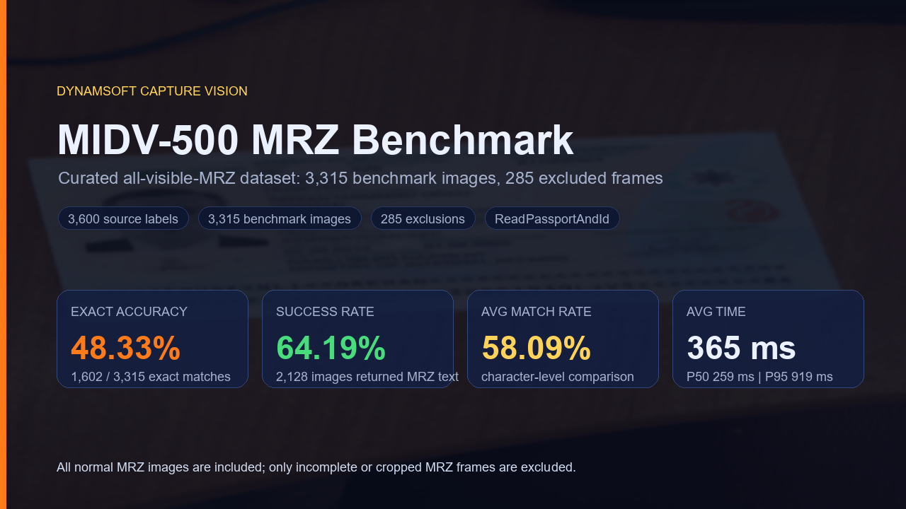

# Dynamsoft Capture Vision MRZ Benchmark (Python)

Benchmark the **Dynamsoft Capture Vision** Python SDK for MRZ recognition on a curated MIDV-500 subset.



## Overview

The preprocessed MIDV-500 MRZ subset contains 3,600 labeled images. During audit, only 285 images were removed from the scoring denominator because the pixels do not support a complete, scoreable MRZ:

- 60 images from `PA17` and `PS17` do not contain a complete MRZ.
- 225 early `PA`/`PS` frames have the MRZ cropped out or not yet visible.

The benchmark now uses the curated `labels.csv` in this project, containing 3,315 scoreable MRZ images. Difficult images with a visible MRZ remain in the benchmark even when the SDK fails to decode them.

The curated set includes 12 MIDV-500 document groups: Azerbaijan passport (`05`), Brazil passport (`06`), Czech passport (`11`), German new passport (`16`), German old passport (`17`), Algerian document with an ID-card style MRZ (`18`), Greek passport (`25`), Croatian passport (`27`), Hungarian passport (`28`), Latvian passport (`32`), Moldovan passport (`34`), and Serbian passport (`41`).

Audit artifacts:

- `assets/midv500_mrz_dataset_audit.json` - audit rules, counts, and before/after summaries
- `assets/midv500_mrz_exclusions.csv` - every excluded image and reason
- `assets/mrz-benchmark-demo.mp4` - short benchmark/audit demo video

## Current Results

The full run below uses the updated all-visible-MRZ curation policy (3,315 images):

| Metric | Original 3,600 labels | Curated 3,315-image benchmark |
|---|---:|---:|
| Exact MRZ matches | 1,603 (44.5%) | 1,602 (48.3%) |
| Successful decodes | 2,139 (59.4%) | 2,128 (64.2%) |
| Average match rate | 53.6% | 58.1% |
| Average decode time | 386.9 ms | 365.2 ms |
| P50 decode time | 283.1 ms | 258.9 ms |
| P95 decode time | 899.6 ms | 919.3 ms |
| P99 decode time | 1,271.0 ms | 1,283.7 ms |

The curated benchmark denominator is smaller but more defensible: it measures MRZ recognition only on images where a complete MRZ is actually visible and scoreable.

## Dataset Layout

Use the preprocessed MIDV-500 MRZ image folder:

```text
dataset_root/
  CA/
    CA05_01.jpg
    CA05_02.jpg
    ...
  CS/
  HA/
  HS/
  KA/
  KS/
  PA/
  PS/
  TA/
  TS/
```

By default, the script uses the bundled curated `labels.csv` from this project. This avoids accidentally scoring against the unfiltered source labels.

## Requirements

- Python 3.8+
- `dynamsoft-capture-vision-bundle`
- `Pillow` for `.tif` to `.jpg` conversion when downloading raw data

Install dependencies:

```bash
pip install -r requirements.txt
```

## Usage

Run the curated accuracy benchmark:

```bash
python benchmark_dcv_mrz.py --dataset /path/to/midv-500-mrz --output benchmark_report_dcv_python_full
```

Use an explicit ground-truth CSV if needed:

```bash
python benchmark_dcv_mrz.py --dataset /path/to/midv-500-mrz --csv labels.csv
```

Run a quick smoke test if you want a small local sanity check:

```bash
python benchmark_dcv_mrz.py --dataset /path/to/midv-500-mrz --limit 5 --output benchmark_report_dcv_python
```

Run speed-only mode for images without ground truth:

```bash
python benchmark_dcv_mrz.py --dataset /path/to/images --no-ground-truth
```

Download raw MIDV-500 source archives for speed-only testing:

```bash
python benchmark_dcv_mrz.py --download --download-limit 1 --no-ground-truth
python benchmark_dcv_mrz.py --download --no-ground-truth
```

Downloaded raw data uses MIDV-500 archive folder names, not the curated `CA/`, `CS/`, etc. label paths, so use `--no-ground-truth` unless you preprocess it into the expected structure.

## Command-Line Options

```text
--dataset PATH          Dataset root folder (or set MRZ_DATASET_DIR)
--csv PATH              Ground-truth CSV path (default: bundled curated labels.csv)
--output PATH           Output folder for report.json and report.html
--runs N                Decode each image N times, keep best timing
--limit N               Process only first N matched images
--license KEY           Dynamsoft license key
--template NAME         Capture Vision template name
--download              Download MIDV-500 source images before benchmarking
--download-limit N      Limit download to N source document groups
--no-ground-truth       Run without ground-truth comparison
```

## Output

The benchmark writes:

- `report.json` - machine-readable summary and per-image results
- `report.html` - visual dashboard with metrics, timing distribution, and per-image details

The included `benchmark_report_dcv_python_full/` report uses the curated 3,315-image benchmark set.

## Files

```text
benchmark_dcv_mrz.py                         Main benchmark script
requirements.txt                             Python dependencies
labels.csv                                   Curated 3,315-image MRZ ground truth
assets/midv500_mrz_dataset_audit.json        Dataset audit summary and rules
assets/midv500_mrz_exclusions.csv            Excluded image manifest
assets/midv500-mrz-benchmark-cover.png       Cover image
assets/mrz-benchmark-demo.mp4                Demo video
benchmark_report_dcv_python_full/            Curated full report
```

## Dataset Source

The MIDV-500 dataset is publicly available at:
https://github.com/fcakyon/midv500

Original dataset DOI: https://doi.org/10.18287/2412-6179-2019-43-5-818-824
